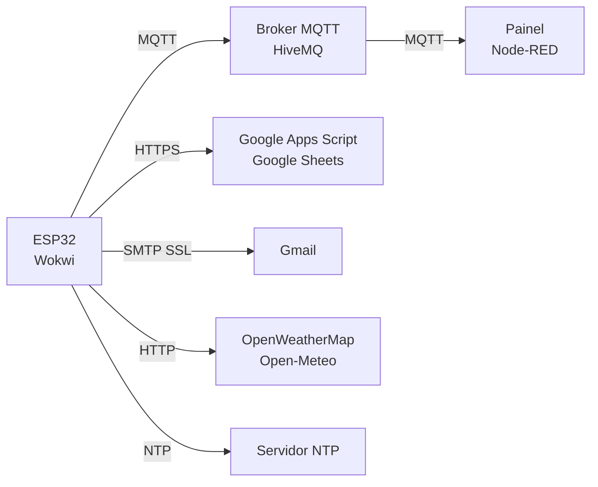

# Estação Meteorológica - ESP32

Projeto acadêmico da disciplina de Internet das Coisas, desenvolvido com ESP32 e MicroPython e simulado no Wokwi, implementando uma estação meteorológica que lê temperatura, umidade, luminosidade e gás, exibe as informações em um display OLED, publica os dados por MQTT para um painel no Node-RED, grava as leituras no Google Sheets e envia um relatório diário por e-mail.

## Escopo

Desenvolver uma estação meteorológica com ESP32, contemplando a leitura dos sensores, o cálculo do índice de conforto térmico, a previsão do tempo a partir da pressão atmosférica, alertas, a publicação dos dados via MQTT, a visualização em uma dashboard, a persistência das leituras em nuvem e o envio automatizado de um relatório diário com as médias de temperatura e umidade.

Toda a lógica de gravação na planilha, cálculo da média e envio do e-mail é executada no próprio ESP32. O Node-RED é usado apenas para visualizar os dados recebidos via MQTT.


## Stack Tecnológico

### Hardware (simulado)

- ESP32 DevKit C V4
- DHT22 (temperatura e umidade do ar)
- Módulo LDR (luminosidade)
- MQ-2 (gás)
- Display OLED SSD1306 128x64 (I2C)
- Botão

### Firmware

- MicroPython 1.22.0
- `umqtt.simple` (cliente MQTT)
- `urequests`, `socket` e `ssl` (requisições HTTP e HTTPS)
- `ntptime` (sincronização do relógio)

### Comunicação e serviços

- Wi-Fi (rede `Wokwi-GUEST` do simulador)
- MQTT, com o broker público do HiveMQ (`broker.hivemq.com`, porta 1883)
- Google Sheets e Google Apps Script (persistência das leituras)
- Gmail, via SMTP com SSL na porta 465 (relatório diário)
- OpenWeatherMap e Open-Meteo (pressão atmosférica)
- Servidor NTP (data e hora)

### Painel

- Node-RED
- Node-RED Dashboard (`node-red-dashboard`)

### Ferramentas

- Wokwi
- Git
- GitHub

## Arquitetura

O ESP32 é o centro da solução e se comunica com cada serviço externo por um protocolo diferente.



| Serviço | Protocolo | Função |
| --- | --- | --- |
| HiveMQ | MQTT (porta 1883) | Recebe as leituras, que são lidas pelo Node-RED e exibidas na dashboard |
| Google Apps Script | HTTPS | Endpoint publicado como aplicativo da Web, que insere cada leitura em uma linha da planilha |
| Gmail | SMTP com SSL (porta 465) | Envio do relatório diário pelo próprio ESP32 |
| OpenWeatherMap e Open-Meteo | HTTP | Pressão atmosférica usada na previsão do tempo |
| Servidor NTP | NTP | Data e hora corretas para cada leitura |

### Tópicos MQTT

Todos os tópicos usam o prefixo `estacao/viniciusborba`.

| Tópico | Conteúdo | Frequência |
| --- | --- | --- |
| `<prefixo>/dados` | Data e hora, temperatura, umidade, índice de calor, luminosidade, gás e alertas | A cada 5 s |
| `<prefixo>/previsao` | Pressão, tendência e previsão do tempo | A cada 1 min |
| `<prefixo>/relatorio` | Data, médias e quantidade de leituras do relatório enviado | A cada envio |
| `<prefixo>/status` | Estado da conexão (`online`) | Ao conectar |

### Ligações

| Componente | Pino | Função |
| --- | --- | --- |
| DHT22 | GPIO 15 | Temperatura e umidade do ar |
| Módulo LDR | GPIO 34 (ADC) | Luminosidade, convertida para lux |
| MQ-2 | GPIO 35 (ADC) | Concentração de gás, em porcentagem da escala |
| Display OLED | GPIO 21 (SDA) e GPIO 22 (SCL) | Exibição das informações |
| Botão | GPIO 4 | Troca de tela e envio manual do relatório |


### Estrutura do projeto

```
estacao-meteorologica/
├── main.py                    # Firmware do ESP32: sensores, display, MQTT, planilha, média e e-mail
├── ssd1306.py                 # Driver do display OLED
├── diagram.json               # Circuito do Wokwi
├── config_exemplo.py          # Modelo das credenciais (copiar para config.py)
├── node-red/
│   └── fluxo-estacao.json     # Fluxo da dashboard no Node-RED
├── apps-script/
│   └── Code.gs                # Endpoint que grava as leituras no Google Sheets
├── prints/                    # Capturas do painel, da planilha, da simulação e do e-mail
├── .gitignore                 # Impede que o config.py seja enviado ao repositório
└── README.md
```

## Funcionalidades

- **Leitura dos sensores**: o DHT22 é lido a cada 2 segundos e os sensores analógicos pelo conversor ADC do ESP32
- **Conforto térmico**: cálculo do índice de calor pela equação de Rothfusz (NOAA) e classificação de Frio a Perigo extremo
- **Luminosidade e qualidade do ar**: conversão da leitura do LDR em lux e classificação da qualidade do ar pelo MQ-2
- **Previsão do tempo**: a pressão atmosférica é consultada a cada minuto no OpenWeatherMap e, se falhar, na Open-Meteo. A previsão combina a pressão, a tendência das últimas leituras, a temperatura e a umidade
- **Data e hora**: o relógio do ESP32 é sincronizado por NTP e ajustado para o horário de Brasília (UTC−3)
- **Display OLED**: seis telas (Clima, Conforto, Luz, Ar, Previsão e Dia), com uma barra de alerta piscando quando há alguma condição crítica
- **Google Sheets**: a cada 30 segundos, uma leitura é enviada ao endpoint do Apps Script, que insere uma linha na aba "Leituras"
- **Média diária**: calculada no próprio ESP32 a partir das leituras do dia. Os acumuladores ficam salvos no arquivo `dia.json`, na memória flash, e são recuperados em caso de reinício
- **Relatório por e-mail**: enviado automaticamente às 23h59 pelo SMTP do Gmail, com a data de referência, as médias de temperatura e umidade, a quantidade de leituras e os valores mínimo e máximo
- **Botão**: um toque curto troca a tela do OLED. Segurar por 1,5 segundo envia o relatório na hora
- **Dashboard**: medidores, gráfico histórico da última hora, previsão, alertas com notificação e o último relatório enviado

### Limites de alerta

| Alerta | Condição |
| --- | --- |
| Temperatura alta | 35 °C ou mais |
| Temperatura baixa | 5 °C ou menos |
| Ar muito seco | Umidade de 20% ou menos |
| Calor perigoso | Índice de calor de 41 °C ou mais |
| Ar poluído ou gás | MQ-2 em 60% ou mais da escala |

## Segurança

As credenciais (chave do OpenWeatherMap, URL e token do Apps Script, e-mail e senha de app do Gmail) não ficam no código. Elas são lidas do arquivo `config.py`, que está no `.gitignore` e não é enviado ao repositório.

Sem o `config.py`, o ESP32 usa o `config_exemplo.py`, com os campos vazios. Nesse caso, a pressão é obtida da Open-Meteo, que não exige chave, e a gravação na planilha e o envio do e-mail ficam desativados. O restante da estação funciona normalmente.

O endpoint do Apps Script só grava dados quando recebe o token correto, o que impede que outras pessoas escrevam na planilha.

## Como executar

### Pré-requisitos

- Navegador e uma conta no [Wokwi](https://wokwi.com) (gratuita)
- Git, para clonar o repositório
- Conta Google, para a planilha e o envio do e-mail (opcional)
- Node-RED com o `node-red-dashboard`, para o painel (opcional)

### 1. Clonar o repositório

```bash
git clone https://github.com/carlosvbr/estacao-meteorologica-iot.git
cd estacao-meteorologica-iot
```

### 2. Configurar as credenciais (opcional)

Para ativar a planilha e o e-mail, copie o arquivo de exemplo:

```powershell
# Windows (PowerShell)
Copy-Item config_exemplo.py config.py
```

```bash
# Linux / macOS
cp config_exemplo.py config.py
```

Edite o `config.py` e preencha:

| Variável | Como obter |
| --- | --- |
| `OWM_API_KEY` | Chave gratuita no [OpenWeatherMap](https://openweathermap.org/api) |
| `PLANILHA_URL` | URL do aplicativo da Web do Apps Script (passo 3) |
| `PLANILHA_TOKEN` | O mesmo valor da constante `TOKEN` no `Code.gs` |
| `EMAIL_REMETENTE` | Endereço do Gmail que vai enviar o relatório |
| `EMAIL_SENHA_APP` | [Senha de app](https://support.google.com/accounts/answer/185833) gerada na conta Google |
| `EMAIL_DESTINOS` | Lista de destinatários do relatório |

O arquivo `config.py` nunca deve ser enviado ao repositório.

### 3. Publicar o endpoint da planilha (opcional)

1. Crie uma planilha no Google Sheets e abra **Extensões > Apps Script**
2. Substitua o conteúdo pelo `apps-script/Code.gs` e defina o valor da constante `TOKEN`
3. Clique em **Implantar > Nova implantação**, escolha o tipo **App da Web** e o acesso **Qualquer pessoa**
4. Copie a URL gerada, terminada em `/exec`, para o `PLANILHA_URL` do `config.py`

### 4. Executar a simulação

1. Abra o projeto no Wokwi (seção [Links](#links)) ou crie um projeto ESP32 MicroPython e adicione os arquivos `main.py`, `ssd1306.py`, `diagram.json` e `config_exemplo.py`
2. Para usar as credenciais, adicione também o `config.py`. Como projetos do Wokwi podem ser abertos por qualquer pessoa com o link, não salve o `config.py` em um projeto compartilhado
3. Clique em play e espere aparecer `Conectando MQTT... OK` no monitor serial

No Wokwi, clique no DHT22, no LDR ou no MQ-2 para alterar os valores. Toque no botão para trocar a tela do OLED ou segure-o por 1,5 segundo para enviar o relatório.

### 5. Executar o painel no Node-RED (opcional)

1. Instale o `node-red-dashboard` pelo gerenciador de paleta
2. Importe o `node-red/fluxo-estacao.json`
3. Faça o deploy e abra `http://localhost:1880/ui`

## Testes

### Testes pela simulação

| Teste | O que fazer | O que acontece |
| --- | --- | --- |
| Temperatura alta | DHT22 em 35 °C ou mais | O OLED pisca "TEMP. ALTA!" e o painel mostra o alerta e a notificação |
| Ar seco | Umidade do DHT22 em 20% ou menos | O alerta "AR MUITO SECO!" é exibido |
| Gás | MQ-2 acima de 60% da escala | O alerta "AR POLUIDO/GAS!" é exibido e a qualidade do ar muda para Ruim |
| Troca de tela | Tocar no botão | O OLED passa para a próxima das seis telas |
| Relatório manual | Segurar o botão por 1,5 segundo | O ESP32 publica o relatório no MQTT e envia o e-mail |

### Resultados

#### Planilha preenchida pelo ESP32


#### Simulação durante o envio do relatório


#### E-mail com o relatório diário


## Dificuldades encontradas

- **Memória durante o relatório**: duas conexões HTTPS seguidas, somadas à conexão MQTT aberta, esgotavam a memória do ESP32 e derrubavam o Wi-Fi. A solução foi calcular a média no próprio ESP32 e fechar a conexão MQTT antes do envio do e-mail
- **Broker MQTT**: a conta nova da HiveMQ Cloud disponibilizava apenas planos pagos, por isso foi utilizado o broker MQTT público da HiveMQ (`broker.hivemq.com`)

## Desenvolvedor

- Carlos Vinicius Borba Ribeiro
